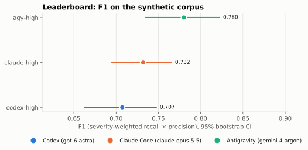
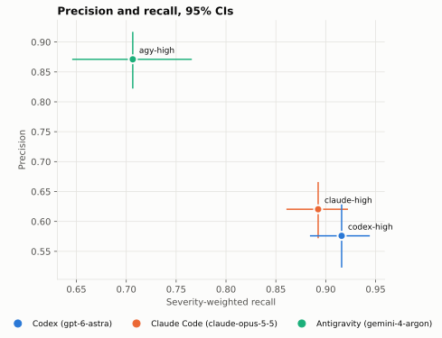

# AI Code Review Benchmark: Codex, Claude Code, Antigravity

Which AI code reviewer actually finds the bugs in a pull request? We gave the same pull requests to three of them — **OpenAI Codex** (`gpt-6-astra`), **Claude Code** (`claude-opus-5-5`) and **Google Antigravity** (`gemini-4-argon`), all at effort `high` — through the same tool, [cross-review](https://www.npmjs.com/package/@tlelabs/cross-review), and graded every finding blind. The method was pre-registered before the runs; the full report, with every statistic, is in [REPORT.md](REPORT.md).

**Short answer:** Codex and Claude Code find the most bugs; Antigravity raises the fewest false alarms. Antigravity has the best F1, because its findings are rarely wrong, but it misses more.

## The leaderboard

144 pull requests with planted bugs, clean changes and decoys, 3 runs each per reviewer. F1 combines severity-weighted recall (wRecall: how much of the bug weight a reviewer found) with precision (how many of its findings were real). False alarms: share of correct pull requests on which the reviewer asked for changes over something that was not a bug. Intervals are 95% bootstrap intervals. Time per run covers setup, the review and, where it ran, a scripted second round.

<!-- crb:leaderboard columns=system,f1,wrecall,precision,false_alarm_rate,median_wall_s -->
| system | F1 [95% CI] | wRecall [95% CI] | Precision [95% CI] | False alarms | Median time per run (s) |
|---|---|---|---|---|---|
| `agy-high` | 0.780 [0.734, 0.822] | 0.707 [0.646, 0.766] | 0.871 [0.822, 0.917] | 5.2% | 325 |
| `claude-high` | 0.732 [0.695, 0.766] | 0.892 [0.861, 0.922] | 0.620 [0.572, 0.666] | 20.7% | 141 |
| `codex-high` | 0.707 [0.663, 0.748] | 0.916 [0.884, 0.944] | 0.576 [0.523, 0.629] | 47.8% | 179 |

The pre-registered rule names a winner only when a pairwise permutation test, Holm-adjusted, gives p below 0.05 on F1. **Antigravity beats Codex. Antigravity and Claude Code tie, and so do Claude Code and Codex.**

## Key findings

**1. Detection: Codex and Claude Code.** They found about nine in ten of the planted bug weight (wRecall 0.916 and 0.892), at every difficulty level, and the difference between them is not significant. Antigravity found 0.707, and fell behind most on bugs that need reading or running code beyond the diff.

**2. Noise: Antigravity.** 87% of Antigravity's findings were real, and it asked for changes on 5.2% of the pull requests that were correct. Claude Code did so on 20.7%, Codex on 47.8%.

**3. Defects nobody planted.** The audit confirmed 60 real defects in the planted pull requests that their authors had not put there. Codex found 48 of them, Claude Code 47 and Antigravity 14.

**4. Real bugs reverse the F1 order, without significance.** On real bugs from public repositories, introduced and fixed after every model's training cutoff, F1 was Codex 0.582, Claude Code 0.528, Antigravity 0.448, with overlapping intervals:

<!-- crb:leaderboard columns=system,realbug_f1,realbug_wrecall,realbug_precision -->
| system | F1 [95% CI] | wRecall [95% CI] | Precision [95% CI] |
|---|---|---|---|
| `codex-high` | 0.582 [0.495, 0.663] | 0.531 [0.406, 0.671] | 0.643 [0.566, 0.714] |
| `claude-high` | 0.528 [0.469, 0.589] | 0.494 [0.409, 0.605] | 0.568 [0.499, 0.637] |
| `agy-high` | 0.448 [0.361, 0.539] | 0.318 [0.237, 0.426] | 0.756 [0.658, 0.848] |

Real pull requests hold many defects besides the one a task was built from, and that is where Antigravity found least. The pattern is the same as on the planted corpus: Antigravity precise, the other two thorough.

**5. Second rounds and fix loops.** When the reviewer saw the author's reply, all three mostly accepted correct fixes, caught wrong ones and held their ground against false rebuttals. When Claude Code or Codex fixed buggy pull requests with a reviewer's help, no reviewer raised the share of bugs fixed over the agent reviewing its own work. The numbers are in [REPORT.md](REPORT.md#track-b-the-second-round).

**6. Speed.** The median run, from setup through the review and any second round, took 141 s for Claude Code, 179 s for Codex and 325 s for Antigravity.

## Which AI code reviewer should you use?

- **Most bugs caught before merge:** Claude Code or Codex. Claude Code catches about as much as Codex with far fewer false alarms, and it is the fastest — a good default.
- **Least noise:** Antigravity. When a false alarm costs more than a missed bug, or as a second opinion, its findings are the most trustworthy. Do not rely on it alone to catch everything.
- **A reviewer that pushes back:** Codex. It was the most sceptical when shown a wrong fix, at the price of the most false alarms.

## How the benchmark works

- **Corpus:** nine production-grade repositories written for the benchmark (TypeScript, Python, Go, Java), 16 pull requests each: 144 planted bugs in 99 buggy pull requests, plus clean and decoy pull requests. Each bug has a hidden test that fails on the pull request and passes after the right fix. A control set of real bugs from public GitHub repositories, fixed after the models' training cutoffs, checks the ranking.
- **Runs:** each review runs in a clean profile, in a fresh copy of the repository, through cross-review's `/review-impl`, with the reviewer free to run the tests. A leakage audit reads every command; runs that reached outside their workspace were run again or excluded.
- **Grading:** findings were anonymised and graded by a blind panel of the three models, by majority. A Claude Code auditor settled disagreements, confirmed new real bugs outside the answer key (credited to every reviewer that found them) and checked a 20% sample. The panel agreed with the audit with a Cohen's kappa of 0.70.
- **Statistics:** bootstrap intervals over tasks, paired permutation tests with Holm correction, Bradley–Terry strengths, and rankings with each repository and each judge left out (the ranking never changed).

## FAQ

**Which AI code reviewer is best?**
It depends on what a mistake costs you. On F1, Antigravity leads and beats Codex significantly. On catching bugs, Codex and Claude Code lead clearly. Claude Code is the best balance of detection, noise and speed in this benchmark.

**Is Codex better than Claude Code at code review?**
Not measurably. They tie on F1, recall and precision. Codex raised more than twice as many false alarms on correct pull requests and topped F1 on real bugs, but neither difference decides a winner under the pre-registered rule.

**Why does Antigravity win on F1 but find fewer bugs?**
F1 rewards precision as much as recall. Antigravity reports fewer findings and most of them are right, so its precision outweighs its lower recall.

**Can I trust a benchmark where the reviewers grade each other?**
The judges never knew whose finding they graded, the decision is a majority of three, a separate audit checked a sample and every disputed case, and the ranking holds with any single judge left out. One caveat is in the report: the Codex judge agreed with the audit less than the others.

**Did Claude write the test corpus?**
Yes, and that is a stated limitation. Claude Code did not top the planted corpus, and the real-bug control set exists to check the ranking on bugs nobody planted.

**How do I run these reviewers on my own pull requests?**
Install [cross-review](https://www.npmjs.com/package/@tlelabs/cross-review) with `npx @tlelabs/cross-review` and run `/review-impl` in Claude Code or Antigravity, or `$review-impl` in Codex. Pick the reviewer in its settings.

## Limitations

- Claude wrote the planted corpus; the real-bug set is small, and its tasks key one bug each while the audit found many more real defects in the same pull requests.
- The judges are the contestants and the auditor is Claude Code; most audit verdicts rest on a written argument rather than a reproduced failure.
- Only effort `high` was tested; the `max` effort systems were dropped for lack of quota.
- The reviewers are subscription CLIs whose models can change on the server side; run dates and versions are in the report.
- Planted bugs proved easy for Codex and Claude Code, so the planted corpus separates them mainly by noise, not detection.

The full list, the deviations from the pre-registration and every number are in [REPORT.md](REPORT.md).
