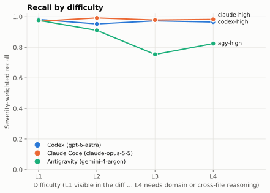
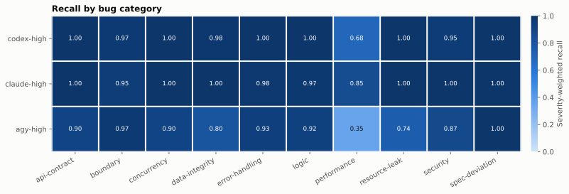
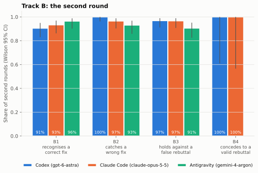
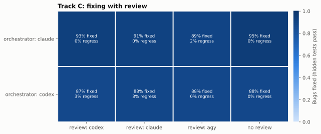
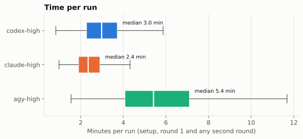

# Cross-Review Bench: which AI code reviewer finds the bugs in a pull request?

## Summary

Three AI reviewers reviewed the same 168 pull requests through [`cross-review`](https://www.npmjs.com/package/@tlelabs/cross-review): Codex (`gpt-6-astra`), Claude Code (`claude-opus-5-5`) and Antigravity (`agy`, `gemini-4-argon`), each at effort `high`, three times per task. A blind panel of the three models graded every finding, and Claude Code audited what the panel could not settle, every candidate for a new bug, and a 20% sample.

- **Primary result: Antigravity has the highest F1 on the planted corpus (0.780), and the pre-registered rule names it the winner over Codex only** (Holm-adjusted p = 0.022). Antigravity against Claude Code (p = 0.098) and Claude Code against Codex (p = 0.213) are ties.
- **The F1 lead is a precision lead, not a detection lead.** Codex and Claude Code found about 90% of the severity-weighted planted bugs (wRecall 0.916 and 0.892); Antigravity found 0.707. Antigravity's findings were right far more often (precision 0.871 against 0.620 and 0.576) and it raised a false alarm on 5% of clean and decoy pull requests, against 21% for Claude Code and 48% for Codex. All four recall and precision gaps between Antigravity and the other two are significant; Codex and Claude Code do not differ significantly on any metric.
- **On 21 real bugs from public repositories the F1 order reverses** (Codex 0.582, Claude Code 0.528, Antigravity 0.448), with overlapping intervals. Real-bug pull requests hold many real defects besides the one each task was built from, and Antigravity found few of them.
- **Defects nobody planted:** of 60 real defects the audit confirmed in the planted corpus, Codex found 48, Claude Code 47 and Antigravity 14.
- **Second rounds (Track B):** all three accept a correct fix, catch a wrong one and hold their position against a false rebuttal in 90–100% of cases.
- **Fixing with review (Track C):** with Claude Code or Codex fixing 40 buggy pull requests, adding any reviewer did not raise the share of bugs fixed over the orchestrator's own review (87–95% in every cell; no difference from "no review" excludes zero).
- **Speed:** median time per run (setup, round 1 and any Track B round) 141 s (Claude Code), 179 s (Codex), 325 s (Antigravity).

**Which to use:** for catching as many defects as possible before a merge, use Codex or Claude Code; Claude Code gives the same detection with less than half Codex's false alarms and is the fastest. Use Antigravity when a quiet reviewer matters more than catching everything: it rarely flags correct code, but it missed about three in ten planted bugs and most unplanted ones. Details under [Recommendation](#recommendation).

## The question

Three AI reviewers review the same pull requests through the same tool, [`cross-review`](https://www.npmjs.com/package/@tlelabs/cross-review) (release `v10.5.1`, commit `2dd22c9`), the way a developer uses it with `/review-impl` before committing:

| Reviewer | CLI | Model | Config `high` |
|---|---|---|---|
| `codex` | OpenAI Codex CLI | `gpt-6-astra` | effort `high` |
| `claude` | Claude Code | `claude-opus-5-5` | effort `high` |
| `agy` | Google Antigravity CLI | `gemini-4-argon` | effort `high` (its highest level) |

A system is one reviewer at one config. The pre-registered design had five systems, adding Codex and Claude Code at effort `max`; `max` was dropped during the final runs (see [Deviations](#deviations-from-pre-registration)), so this report compares three. The primary comparison is F1 over the synthetic corpus. Everything below was fixed before the final runs in [`METHODOLOGY.md`](../METHODOLOGY.md) (bench tag `prereg-v1`, commit `cafef43e`; corpus tag `corpus-v1`, commit `65ab06a7`, tree `1003d6cf`). This report summarises the method; the methodology is the reference.

## Method in brief

**Corpus.** Nine production-grade repositories written for the benchmark (TypeScript, Python, Go and Java; two or three per language), each with 16 pull requests: 11 with 16 planted bugs between them, 3 clean, 2 decoys (code that looks wrong but is right). 144 tasks, 144 planted bugs. Every bug has a location, category, severity (weights 4/3/2/1), difficulty (L1 visible in the hunk … L4 needs running code or domain knowledge), a hidden test that fails on the pull request and passes after the correct fix, a plausible wrong fix and a plausible false rebuttal. `crb validate` proves each of these by execution. A control set of 24 real bugs from public repositories (6 per language), introduced and fixed by pull requests merged after every contestant's training cutoff, checks whether the ranking holds on defects nobody planted.

**Runs.** Each run is a fresh profile holding only the CLI's login, a fresh copy of the repository with the pull request applied under an opaque path, its own Postgres and Redis database, and one call of the pinned runner exactly as the `review-impl` skill makes it. Reviewers run vanilla, in full-access mode, and may run the tests. Every task runs three times per system: 168 tasks × 3 systems × 3 = 1,512 runs. A leakage audit reads every command and tool call of every run; a run that reaches outside its workspace is run again, and a run flagged twice is excluded as contaminated.

**Grading.** Findings are anonymised, shuffled per task and graded by a blind panel of the three contestants at `high`, each with the task's answer key and workspace. A finding is real when it describes a defect the pull request introduces or relies on that a competent maintainer would fix before merging. Real findings that match no planted bug are pooled into new bugs after an audit, and every reviewer that found one is credited. Claude Code audits every finding the panel cannot settle, every pooled candidate and a 20% sample of each reviewer's findings, with a reproducing command or a written argument citing the code; agreement is reported as Cohen's kappa.

**Metrics.** Over tasks, round 1 only: severity-weighted recall (wRecall), precision and their F1 (primary); false alarms on clean and decoy tasks; location accuracy; pass^3 and pass@3; breakdowns by difficulty, category, severity and language; wall time and output tokens per run. **Statistics:** stratified bootstrap 95% intervals (10,000 resamples); within-task permutation tests on the three pairs, Holm-adjusted; a reviewer wins only when the adjusted p of F1 is below 0.05, otherwise the report calls a tie. Bradley–Terry strengths, leave-one-repository-out and leave-one-judge-out rankings, and Kendall's τ against the real bugs test robustness.

**Track B** gives the reviewers a scripted second round: the correct fix (B1), a wrong fix (B2), a false rebuttal (B3) or, on decoys, a valid rebuttal (B4). **Track C** runs 320 full loops: Claude Code or Codex fixes 40 buggy pull requests with `review-impl` and each reviewer, or with its own review only, and hidden tests decide what got fixed.

## Results

All numbers come from `results/scores.jsonl` through `analysis/` (`python -m crb_analysis.report`, seed 20261017); the tables are in `report/tables/` and the figures in `report/figures/`.

### Leaderboard

Synthetic corpus, 144 tasks (none dropped), config `high`, 3 runs per task. False alarms: share of clean and decoy runs that ask for changes with at least one finding judged not real. pass^3 / pass@3: share of bugs found in all / any of the three runs, over the tasks a system has all three scored runs of (a contaminated run leaves its task out: 35 bugs for Claude Code, 7 for Codex, none for Antigravity). Median wall time spans the whole run: setup, round 1 and, where it ran, the Track B round.

<!-- crb:leaderboard columns=system,f1,wrecall,precision,false_alarm_rate,location_accuracy,pass_all_k,pass_any_k,median_wall_s,median_output_tokens -->
| system | F1 [95% CI] | wRecall [95% CI] | Precision [95% CI] | False alarms | Location accuracy | pass^3 | pass@3 | Median wall time (s) | Median output tokens |
|---|---|---|---|---|---|---|---|---|---|
| `agy-high` | 0.780 [0.734, 0.822] | 0.707 [0.646, 0.766] | 0.871 [0.822, 0.917] | 5.2% | 0.962 | 0.598 | 0.686 | 325 | 14,019 |
| `claude-high` | 0.732 [0.695, 0.766] | 0.892 [0.861, 0.922] | 0.620 [0.572, 0.666] | 20.7% | 0.918 | 0.734 | 0.917 | 141 | 7,355 |
| `codex-high` | 0.707 [0.663, 0.748] | 0.916 [0.884, 0.944] | 0.576 [0.523, 0.629] | 47.8% | 0.922 | 0.817 | 0.909 | 179 | 3,682 |


### Pairwise tests

Within-task permutation tests (10,000 permutations), Holm-adjusted over the three pairs of each metric. MDE is the difference each pair could detect with 80% power.

| Metric | Pair | Difference | p | Holm p | Winner | MDE |
|---|---|---|---|---|---|---|
| **F1** | Codex − Claude Code | −0.025 | 0.213 | 0.213 | tie | 0.061 |
| **F1** | Codex − Antigravity | −0.073 | 0.007 | **0.022** | **Antigravity** | 0.086 |
| **F1** | Claude Code − Antigravity | −0.048 | 0.049 | 0.098 | tie | 0.084 |
| wRecall | Codex − Claude Code | +0.024 | 0.213 | 0.213 | tie | 0.058 |
| wRecall | Codex − Antigravity | +0.209 | < 0.001 | < 0.001 | Codex | 0.097 |
| wRecall | Claude Code − Antigravity | +0.186 | < 0.001 | < 0.001 | Claude Code | 0.095 |
| Precision | Codex − Claude Code | −0.044 | 0.072 | 0.072 | tie | 0.074 |
| Precision | Codex − Antigravity | −0.295 | < 0.001 | < 0.001 | Antigravity | 0.095 |
| Precision | Claude Code − Antigravity | −0.251 | < 0.001 | < 0.001 | Antigravity | 0.099 |

By the pre-registered rule (Holm-adjusted p of F1 below 0.05), **Antigravity beats Codex; the other two pairs tie.** Bradley–Terry strengths from per-task F1 wins are close to zero for all three (Antigravity +0.01 [−0.18, 0.21], Claude Code +0.02 [−0.16, 0.20], Codex −0.03 [−0.22, 0.15]). They count wins only on tasks with bugs, and there each system wins about as often as it loses. The aggregate F1 also sums findings on the clean and decoy tasks, where Antigravity's few findings keep its precision high. The MDEs of 0.06–0.09 match the pilot's estimate (0.058–0.068 at 144 tasks) for the pairs involving Claude Code and Codex and are larger for Antigravity, whose results vary more between tasks.

### Precision, recall and false alarms


The three reviewers trade detection for noise in different places. Codex and Claude Code report more: they find nine in ten planted bugs and many real defects outside the answer key (see [Unplanted defects](#unplanted-defects)), but 38–42% of their findings are not real. Antigravity reports less: 87% of its findings are real, and on the 135 clean and decoy runs it asked for changes 9 times (7 with a finding judged not real), against 29 for Claude Code and 64 of 134 for Codex. Codex asked for changes on almost half of the pull requests that were correct.

Consistency across the three runs follows detection: Codex found 82% of planted bugs in every run and 91% in at least one, Claude Code 76% and 92%, Antigravity 60% and 69%. All three located what they found well (92–96% of matched findings name the bug's file within ±3 lines).

### By difficulty, category, severity and language

Severity-weighted recall:

| System | L1 | L2 | L3 | L4 | Pooled bugs |
|---|---|---|---|---|---|
| Codex | 0.982 | 0.953 | 0.973 | 0.965 | 0.729 |
| Claude Code | 0.970 | 0.992 | 0.978 | 0.982 | 0.555 |
| Antigravity | 0.976 | 0.911 | 0.753 | 0.825 | 0.155 |



Codex and Claude Code find planted bugs at every difficulty level (95–99%), as calibration predicted (limitation 12): the difficulty labels do not separate them. Antigravity matches them at L1 and falls off at L3 and L4, the bugs that need reading beyond the hunk or running the code. By severity, all three find nearly every critical bug (0.93–1.00); Antigravity's gap widens on high (0.760 against 0.971–0.994) and medium bugs (0.626 against 0.829–0.894), and every reviewer finds fewer low-severity bugs (0.39–0.64).

By category (`tables/recall_by_category.md`), Codex and Claude Code reach 0.94–1.00 everywhere except performance (0.683 and 0.850); Antigravity is lowest on performance (0.350), resource leaks (0.739) and data integrity (0.795).



By language:

| Language | Codex F1 | Claude Code F1 | Antigravity F1 | Antigravity precision | Antigravity wRecall |
|---|---|---|---|---|---|
| Go | 0.706 | 0.708 | 0.703 | 0.754 | 0.659 |
| Java | 0.731 | 0.737 | 0.823 | 0.936 | 0.735 |
| Python | 0.724 | 0.733 | 0.812 | 0.890 | 0.747 |
| TypeScript | 0.684 | 0.751 | 0.800 | 0.926 | 0.704 |

The ranking holds in Java, Python and TypeScript; in Go the three are level, because Antigravity's precision there (0.754) is not much above the others' (0.569–0.586). These are descriptive; the breakdowns were not tested.

### Track B: the second round

The harness plays the orchestrator and answers the reviewer's round-1 findings by scenario; a run whose round 1 did not flag the bug or decoy gets no second round (`n/a`).

| System | B1 accepts a correct fix | B2 catches a wrong fix | B3 holds against a false rebuttal | B4 concedes to a valid rebuttal |
|---|---|---|---|---|
| Codex | 0.905 [0.830, 0.949], n = 95 | 1.000 [0.962, 1.000], n = 97 | 0.968 [0.911, 0.989], n = 95 | 6 of 6 |
| Claude Code | 0.933 [0.862, 0.969], n = 90 | 0.966 [0.903, 0.988], n = 87 | 0.967 [0.908, 0.989], n = 91 | 5 of 5 |
| Antigravity | 0.965 [0.901, 0.988], n = 85 | 0.931 [0.858, 0.968], n = 87 | 0.906 [0.825, 0.952], n = 85 | — (0 played) |

Wilson 95% intervals. All three handle the second round well, and every interval overlaps. Codex is the most sceptical (it caught every wrong fix, and accepted the correct fix least often), Antigravity the most agreeable (it accepted correct fixes most often and held against false rebuttals least often). Four of Codex's nine B1 misses, two of Claude Code's six and all three of Antigravity's fall on four bugs whose reference fix the auditors found incomplete (see [Limitations](#limitations)); without those tasks B1 is 0.945 (Codex), 0.953 (Claude Code) and 1.000 (Antigravity) (exploratory). B4 is almost never played: a reviewer rarely flagged a decoy, so a valid rebuttal was seldom needed (Antigravity flagged none). New valid findings in round 2 were rare (at most 0.02 per second round).



### Track C: fixing with review

Each of 40 buggy tasks ran once per orchestrator and cell; 12 of the 320 loops were excluded as contaminated, so cells hold 34–40 loops. Fixed: share of testable bugs whose hidden tests pass after the loop. Regression: the visible tests fail.

| Orchestrator | Cell | Loops | Fixed [95% CI] | Regressions | Review rounds (mean) | Median wall time (s) |
|---|---|---|---|---|---|---|
| Claude Code | Codex | 39 | 0.929 [0.860, 0.983] | 0 | 2.1 | 330 |
| Claude Code | Claude Code | 34 | 0.913 [0.830, 0.979] | 0 | 1.9 | 277 |
| Claude Code | Antigravity | 40 | 0.895 [0.797, 0.979] | 1 | 2.0 | 492 |
| Claude Code | none | 40 | 0.947 [0.887, 1.000] | 0 | — | 176 |
| Codex | Codex | 39 | 0.873 [0.784, 0.947] | 1 | 3.1 | 375 |
| Codex | Claude Code | 36 | 0.885 [0.800, 0.961] | 1 | 1.8 | 275 |
| Codex | Antigravity | 40 | 0.877 [0.797, 0.949] | 0 | 1.4 | 424 |
| Codex | none | 40 | 0.877 [0.796, 0.948] | 0 | — | 227 |

Paired difference from "none" on the same tasks:

| Orchestrator | Cell | Tasks | Difference [95% CI] |
|---|---|---|---|
| Claude Code | Codex | 39 | −0.018 [−0.102, 0.056] |
| Claude Code | Claude Code | 34 | −0.043 [−0.116, 0.000] |
| Claude Code | Antigravity | 40 | −0.053 [−0.151, 0.020] |
| Codex | Codex | 39 | 0.000 [−0.056, 0.050] |
| Codex | Claude Code | 36 | +0.019 [−0.064, 0.103] |
| Codex | Antigravity | 40 | 0.000 [0.000, 0.000] |

**No reviewer cell fixed measurably more bugs than the orchestrator reviewing its own work.** Both orchestrators already fixed most bugs alone (Claude Code 95%, Codex 88%), which leaves little room; per task, a cell differs from "none" on at most 5 of 40 tasks, in both directions, and Codex with Antigravity fixed exactly the same bugs as Codex alone on every task. Review added 20–180% to the median wall time. Regressions were rare (at most 1 per cell). On these tasks, then, a second model's review bought time and a second opinion, not more fixed bugs; whether it helps on harder changes is open.



### Real bugs

24 real bugs were accepted (6 per language); 3 are left out because some reviewer has no scored run on them (all three runs contaminated: `rb-py-lmcache-4748`, `rb-ts-codex-security-1729`, `rb-ts-oh-my-opencode-slim-1366`), leaving 21. Intervals resample tasks within language (see [Deviations](#deviations-from-pre-registration)).

<!-- crb:leaderboard columns=system,realbug_f1,realbug_wrecall,realbug_precision -->
| system | F1 [95% CI] | wRecall [95% CI] | Precision [95% CI] |
|---|---|---|---|
| `codex-high` | 0.582 [0.495, 0.663] | 0.531 [0.406, 0.671] | 0.643 [0.566, 0.714] |
| `claude-high` | 0.528 [0.469, 0.589] | 0.494 [0.409, 0.605] | 0.568 [0.499, 0.637] |
| `agy-high` | 0.448 [0.361, 0.539] | 0.318 [0.237, 0.426] | 0.756 [0.658, 0.848] |

The F1 order on real bugs is the reverse of the synthetic one: Kendall's τ = −1.00. With three systems τ cannot reach significance (p = 0.33), and the three intervals overlap, so the real bugs neither confirm nor refute the synthetic ranking. They do confirm its mechanism: Antigravity is again the most precise and the least thorough, and Codex and Claude Code again find more.

Two things make the real-bug numbers different in kind. First, each real-bug task scores one keyed bug, but the audit confirmed 111 further real defects in the same 24 pull requests (up to 20 in one), so 82% of the real-bug pool is pooled bugs, and wRecall here mostly measures how many of a real pull request's other defects a reviewer finds — where Antigravity was weakest on the synthetic corpus too (0.155 against 0.555–0.729). Second, the keyed bugs alone (exploratory, not pre-registered): Claude Code found the keyed bug in 40 of its 68 scored real-bug runs (59%), Codex in 28 of 59 (47%), Antigravity in 26 of 59 (44%) — all far below the synthetic recall, as calibration predicted (10 of 24 for `claude-sonnet-5-5`).

### Unplanted defects

The audit confirmed 60 real defects in the synthetic pull requests that their authors did not plant (pooled bugs; 171 across the whole corpus).

| System | Pooled bugs on synthetic tasks | Found in at least one run | wRecall |
|---|---|---|---|
| Codex | 60 | 48 | 0.729 |
| Claude Code | 60 | 47 | 0.555 |
| Antigravity | 60 | 14 | 0.155 |

These are defects someone found and the audit confirmed, so they favour the reviewers that report more; they are a secondary metric.

### Cost: time and tokens

| System | Median wall time per run (s) | Median output tokens, round 1 |
|---|---|---|
| Claude Code | 141 | 7,355 |
| Codex | 179 | 3,682 |
| Antigravity | 325 | 14,019 |



Wall time spans the whole run: building the profile and the workspace, round 1 and, when round 1 flagged the bug or decoy, the Track B round; it is not the review alone. Claude Code was the fastest and Antigravity took more than twice as long. Output tokens come from each CLI's own usage report and tokenizer, so they compare a system's runs with each other, not one vendor with another. The reviewers ran on subscription CLIs, so no per-run price is reported.

## Grading quality

**Panel.** 4,561 findings (2,938 from round 1, 1,623 from Track B second rounds) on 168 tasks were graded by the three judges in 463 judge calls (459, plus 4 asked again after the stall fix in Deviations).

**Audit.** 1,180 items, all closed before scoring:

| Reason | Items |
|---|---|
| Random 20% sample per reviewer | 914 |
| Pool candidates (groups of findings outside the key) | 255 |
| Judge failure (too few judges answered) | 35 |
| Inconsistent (majority named a bug but called the finding not real) | 8 |
| Uncertain | 4 |
| Tie | 4 |

Verdicts: 776 real, 404 not real. 20 were decided by a reproducing command (17 showed the defect, 2 did not, 1 not applicable); the other 1,160 by a written argument citing the code. Several real-bug workspaces cannot run all their tests offline, and the auditors reproduced by command only where a finding was in doubt, so the audit is mostly argued, not executed (see [Limitations](#limitations)). The 255 pool candidates became 171 pooled bugs (14 high, 100 medium, 57 low severity); the re-check of each pooled bug against the other findings of its task settled every match by majority and queued no further audit.

**Agreement with the audit** (Cohen's kappa, on the 925 sampled findings):

| Judge | All findings | Codex's findings | Claude Code's findings | Antigravity's findings |
|---|---|---|---|---|
| Panel (majority) | 0.70 | 0.66 | 0.71 | 0.67 |
| Claude Code | 0.76 | 0.76 | 0.73 | 0.67 |
| Antigravity | 0.69 | 0.63 | 0.71 | 0.74 |
| Codex | 0.39 | 0.18 | 0.52 | 0.72 |

The panel agrees substantially with the audit (0.70). The Codex judge agrees much less (0.39), and least of all on Codex's own findings (0.18): it judged its own model's findings differently from the auditor far more often than the other judges did. The panel's majority absorbs this: leaving out any one judge, the Codex judge included, leaves the ranking unchanged (`tables/robustness.md`). The auditor is Claude Code, so kappa against the audit is not neutral either (limitation 4).

**Robustness.** The F1 ranking (Antigravity > Claude Code > Codex) is the same with any one of the nine repositories left out and with any one judge left out.

## Runs, failures and contamination

All 1,512 Track A runs and 320 Track C loops were archived (`report/run-log.md`). Runs took place 2026-10-20 to 2026-10-26.

| | Codex | Claude Code | Antigravity |
|---|---|---|---|
| Track A runs scored (of 504) | 486 | 476 | 491 |
| Contaminated (two flagged attempts): synthetic / real bugs | 5 / 13 | 24 / 4 | 0 / 13 |
| Reviewer failure (`reviewer_malformed`) | 0 | 0 | 1 |
| Infrastructure retries exhausted | 0 | 0 | 0 |

71 runs were excluded as contaminated (59 in Track A, 12 in Track C). In the last attempt of each, the audit's flags were:
- **`shared_tmp`** for most of them, notably Claude Code's 24 synthetic runs. These are listings or globs of the machine's shared temp folders, usually a reviewer looking for the folder its own `mktemp` had created outside the run.
- **`real_home`** (the user's home outside the read-only toolchain folders) or **`user_data`** for most Antigravity and Codex real-bug exclusions, often a build tool reaching the real Maven or Go cache.
- **`upstream`** (the real-bug repository on the network) twice.

Contamination fell unevenly: 3.6% of Codex's Track A runs, 5.6% of Claude Code's and 2.6% of Antigravity's; on real bugs, 18% of Codex's and Antigravity's runs and 5.6% of Claude Code's. Excluded runs are not scored; a task stays in the synthetic statistics only if every system has a scored run on it, which all 144 do.

Codex hit its subscription's usage limit several times during 2026-10-25/26. The scheduler paused Codex and retried, and the account was moved to another Pro subscription for the last Track C loops and the grading re-checks. The CLI, model and effort did not change. Antigravity's CLI moved from 1.4.3 to 1.4.7 during the runs (the version of every run is in its record).

## Deviations from pre-registration

- **Config `max` dropped** (2026-10-24, during the final runs): the five-system design lost its two `max` systems (Codex and Claude Code at effort `max`) for lack of reviewer quota. A `max` run cost about 1.7× (Codex) and 4× (Claude Code) the input tokens of a `high` run, and the remaining `max` runs would have cost about as much as all of Track A at `high`. The 64 `max` runs already made were not graded or scored. The primary comparison, the three systems at `high`, and Tracks B and C are unchanged; whether `max` effort finds more bugs stays open.
- **Real-bug intervals stratified by language** (analysis commit `39b987a`): the pre-registered bootstrap is stratified by repository. Every real bug comes from a repository of its own, so that bootstrap drew the same tasks in every replicate and gave zero-width intervals. Real-bug intervals now resample tasks within each language (6 per language). The point estimates and the synthetic statistics do not change. The same commit adds real-bug wRecall and precision with intervals to the leaderboard (descriptive).
- **Figure layout** (commit `0bcc5e7`, after `prereg-v1`): legends under short figures no longer overlap the axis label. No statistic changes.
- **Batch hold** (commit `4de7008`, after `prereg-v1`): a batch starts no new run while another heavy job on the machine runs; runs already started finish. No run, scoring or analysis rule changes.
- **Shared temp directory** (harness bug found during the final runs; fix commit `108d6a8`): reviewers inherited the machine's `TMPDIR`, shared by every concurrent run, and the audit passed `/tmp` and `/var/folders`. Some runs listed or globbed those roots, often looking for their own `mktemp` directory (`ls -td $TMPDIR/tmp.* | head -1`), and could have landed in another run's scratch. Each run now gets its own `TMPDIR` inside its run directory, deleted with it; Python, Node and Go follow it, while macOS `mktemp` without a template still uses the user's temp directory, under a random name. Isolation therefore rests on the audit, which now flags a listing of a shared temp root, a glob among its entries, or a search of it by any name other than an instruction file (`shared_tmp`). Following the methodology, every final run archived before the fix was re-audited with the new rule. A run flagged for the first time was run again, and a run flagged twice was excluded as contaminated. A regression test covers both parts. Runs the rule does not flag kept their result; no fixed (non-random) name in a shared temp root was used by two runs whose times overlapped.
- **Flag count across batches** (commit `108d6a8`): a run's flag count now includes flagged attempts archived by earlier batches, so "flagged twice → contaminated" also holds when a batch is restarted. The final runs had not been restarted before the fix, so no earlier decision changes.
- **Upstream rule narrowed** (2026-10-25, during the final runs; harness commit `7bcf4b5`): the pre-registered audit flagged a real-bug run when the upstream repository was named in any tool input. A Go import path or Java package name in a test the reviewer wrote to check a finding names it too, so writing such a test flagged the run although it reached nothing: 18 of 345 flags, on three real-bug tasks, for Claude Code and Codex. The rule now flags the upstream repository where a tool reaches it: a web search or fetch naming it, a URL to it, or a fetch command naming it. It only drops flags, never adds one. Every run was replayed under it, as the scheduler would have decided: 8 runs got their first clean attempt back as their result, no run needed a new attempt, and attempts that would not have run are kept apart and not scored. The change was decided from the commands that triggered the flags, before any finding was graded.
- **Judge stall window widened** (2026-10-26, harness commit `3e6dc72`): a judge writes its whole answer in one final message, and on four tasks with 31–140 findings that took longer than the pinned runner's default stall window (12 polls, about 3 minutes), so every attempt of 4 of the 459 judge calls was cut off. Judges now get a 20-minute silent window; the one-hour call deadline is unchanged. Only those 4 judgments were asked again; no judgment that had already succeeded was repeated.
- **Pooled-bug re-checks in parallel** (harness commit `672d44c`): `crb pool --concurrency 3` judges three pooled bugs at once and writes the results in pool order, exactly as one at a time (a test compares the two). Speed only; no grading rule changes.
- **pass^3 / pass@3 corrected** (final review, 2026-10-26): the analysis counted the bugs of a task left with fewer than three scored runs (a run excluded as contaminated) as if it had three. They are now left out, as `METHODOLOGY.md` defines the metric over three runs: 35 bugs for Claude Code (pass^3 0.760 → 0.734) and 7 for Codex (0.819 → 0.817, pass@3 0.907 → 0.909). No other number changes.
- **Run-root audit rule widened** (final review, 2026-10-26): the audit passed any access to the run root `/tmp/crw` itself, so a recursive search or full listing of it, or of a folder above it (`rg secret /tmp/crw`, `find / -type f`), would have reached every concurrent run's files unflagged. It now flags such a listing or content search as `other_run`. A search by name only (`find / -name pytest`, with tests on size or age; `rg --files` held to named globs; `fd` without `--exec`) prints paths, not contents, and stays allowed, as before. Re-auditing every final run with the new rule flagged no run that was not already contaminated, so no result changed. A scan of all final transcripts found no clean run whose commands named another run's path; such paths appear only in command output (`ps` listings, tool hunts, instruction-file searches, the shared Go build cache), and no run read another run's files.
- **Harness fixes from the final review** (2026-10-26), none of which changes a published number: Track C's runner now waits until the orchestrator's whole process group has exited, including after a timeout, before tearing the run down (a child that outlived a timed-out loop could not be checked afterwards; that remains a residual risk for the Track C loops that timed out); grading records the content of each finding it graded, so a run attempt replaced after grading is judged, audited and re-checked again instead of inheriting the old attempt's grades (no final archive changed after its task was first judged); and pass^3 / pass@3 as above.
- **One audit batch split over helpers**: one Claude Code auditor handed 10 of its 26 pooled-bug candidates to three helper instances of itself. They saw the same blind packets and recorded under the same rules; nothing else about the audit changed.
- **Blinding slip** (2026-10-26): a check during grading printed, by reviewer, how many Track B scenarios had no second round. It was a count of runs, not of scores, printed after every Track A run was final; no run, grading or analysis decision was made after it.

## Limitations

The pre-registered limitations, with what the results say about each:

1. **Claude wrote the corpus.** Its bugs may suit the reviewer that shares Claude's habits. Claude Code did not top the planted corpus; on real bugs it sat between the other two, as on the planted ones.
2. **Authoring and audit models.** Claude Opus 5.5 wrote and audited most of the corpus; Claude Haiku 5.5 wrote or audited part of it, and every such part was audited again by Opus 5.5.
3. **Judges are the contestants.** The Codex judge agreed with the audit much less than the others, least on Codex's own findings (kappa 0.18). The ranking does not depend on any one judge (leave-one-judge-out), but per-finding verdicts carry that disagreement.
4. **The audit is Claude Code.** It shares a vendor with a contestant, and 1,160 of its 1,180 verdicts rest on a written argument rather than an executed reproduction.
5. **Calibration** used `claude-sonnet-5-5`, which shares a vendor with a contestant.
6. **Track C has cross-review installed**, the tool under test; Track A and B reviewers are vanilla.
7. **No `max` systems.** Antigravity has no `max`, and Codex and Claude Code at `max` were dropped (Deviations), so the effect of more reasoning effort is not measured.
8. **Subscription CLIs.** The model behind a name can change on the server side; the run dates and each run's CLI version are recorded. Antigravity's CLI changed version during the runs, and Codex's account changed during the last Track C loops and re-checks.
9. **Real bugs.** 24 bugs, 21 scored; repositories with at least 100 stars in the third mining stage; each task keys one bug although the audit found many more real defects in the same pull requests (82% of the real-bug pool), so real-bug recall mostly measures those. Three real-bug workspaces had flaws every reviewer saw alike: `rb-go-gpt-load-887` has a stale `vendor/`, `rb-go-grype-3809` does not vendor `syft`, and `rb-py-agents-7783` carries unrelated branch changes. Several real-bug workspaces cannot run all their tests offline, so reviewers and auditors argued from the code there.
10. **Rubric targets missed after audits** in `gateway-go`, `booking-java` and `workflow-java` (difficulty and severity counts in METHODOLOGY).
11. **`rb-java-ozone-10988`** needs a Maven bypass to build; every reviewer had the same environment.
12. **Synthetic detection near the ceiling**, as calibration warned. Codex and Claude Code found 95–99% of planted bugs at every difficulty, so the corpus separates them by precision, false alarms and unplanted defects, not by planted recall.

Found during grading:

13. **Incomplete reference fixes.** The auditors found the reference fix incomplete for four bugs (`etl-py-T11` B2, `authz-py-T07` B1, and one bug in each of two private Go tasks). Track B's B1 scenario applies the reference fix, so a reviewer that flags what the fix left undone is scored as not recognising the fix. These four bugs account for 9 of the 18 B1 misses (sensitivity analysis under Track B).
14. **Task wording.** In a few tasks the description disagrees with the code or the key (`etl-py-T04` exit codes, and one bug's wording in each of three private tasks). The panel and the audit judged findings against the code.
15. **Uneven contamination.** Excluded runs are not missing at random. Real-bug runs that reached outside the workspace were more often Codex's and Antigravity's (13 each, against Claude Code's 4), and three real bugs lost every run of some reviewer.

## Reproducibility

- **Code:** bench at the commit of this report; pre-registration tag `prereg-v1` (`cafef43e`); corpus tag `corpus-v1` (`65ab06a7`, tree `1003d6cf`); cross-review `v10.5.1` (`2dd22c9`), pinned in `~/.crbench/cross-review-v10.5.1`.
- **Contestants:** `codex-cli 0.163.0` (`gpt-6-astra`); Claude Code `2.1.301` (`claude-opus-5-5`); Antigravity CLI `1.4.3`–`1.4.7` (`gemini-4-argon`); each at effort `high`. Track A runs 2026-10-20 to 2026-10-25, Track C loops 2026-10-22 to 2026-10-26, grading 2026-10-25 to 2026-10-26.
- **Host:** macOS (Apple silicon), Node `26.11.1`, Python `3.14.6` with `uv 0.11.17`, JDK 21, Postgres and Redis in colima.
- **Pilot labels**, opened after the final scores: X = Antigravity, Y = Codex, Z = Claude Code (`pilot/PILOT.md`).
- **Commands:**

```bash
node harness/bin/crb.js run --set final --track A --config high --tasks <task list>     # Track A with Track B
node harness/bin/crb.js trackc --set final --tasks trackc/tasks.txt --orchestrators claude,codex --cells codex,claude,agy,none
node harness/bin/crb.js audit --set final --all
node harness/bin/crb.js judge --set final
node harness/bin/crb.js pool --set final --concurrency 3                                # until nothing is left to re-check
node harness/bin/crb.js audit-queue status --set final                                  # 0 open
node harness/bin/crb.js score --set final                                               # results/scores.jsonl, agreement.json, pool.json
uv run --project analysis python -m crb_analysis.report --scores results/scores.jsonl --out report/
node harness/bin/crb.js check-report
```

The release bundle (`crb export`) holds the public-split tasks with their answer keys, the real bugs, the public runs and their scores, the harness, the analysis and this report, with a SHA-256 manifest.

## Recommendation

**To catch as many bugs as possible before a merge, use Codex or Claude Code.** They tie on detection (wRecall 0.916 and 0.892, F1 not significantly different), each found about nine in ten planted bugs at every difficulty, and they found three times as many unplanted defects as Antigravity. Between the two, **Claude Code is the better default**: it raised false alarms on 21% of correct pull requests against Codex's 48%, it was the fastest (median 141 s), and it found the keyed bug in the most real-bug runs. Codex is the most sceptical in a second round (it caught every wrong fix) and topped real-bug F1, so it suits a team that prefers a reviewer that pushes back and accepts triaging more findings.

**For a quiet reviewer, use Antigravity.** Its findings were right 87% of the time and it almost never objected to a correct pull request (5%), which is why it leads F1 and beats Codex there. The price is detection: it missed about a quarter of the high-severity and a third of the medium-severity planted bugs and most defects outside the answer key, it falls off on bugs that need reading or running beyond the diff (L3, L4), and it was the slowest. It suits a second opinion where noise is costly, not a sole gate.

**By language**, Antigravity's F1 lead holds in Java, Python and TypeScript; in Go the three are level. **In a fix loop** (Track C), where a strong agent already reviews its own work, none of the three reviewers raised the share of bugs fixed on these tasks; expect review there to cost time and catch things the tests do not, rather than to raise the fix rate.
